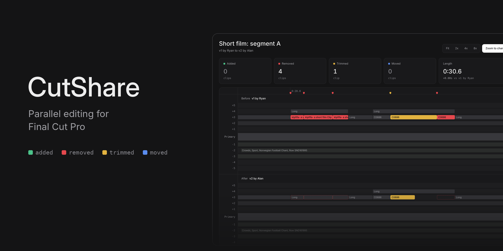
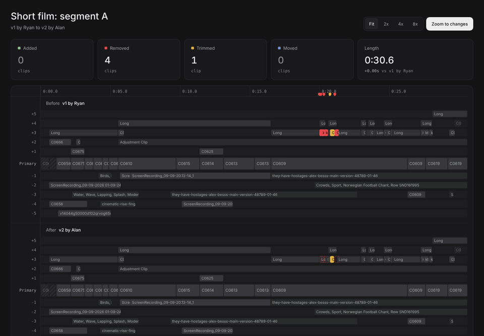
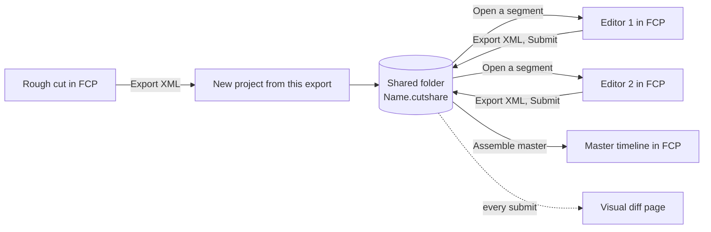
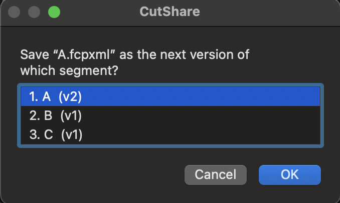
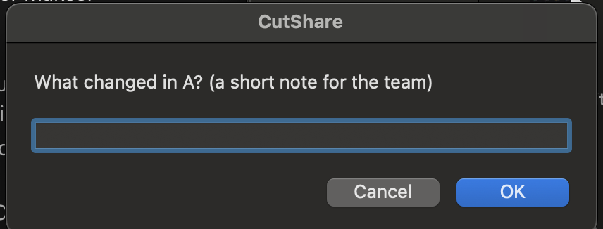
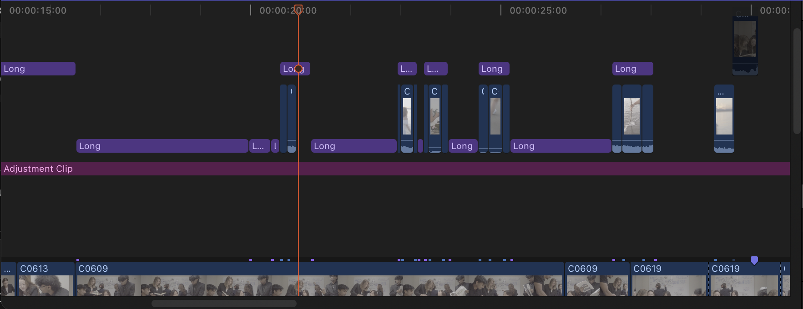

<p align="center"></p>

# CutShare

**Parallel editing for Final Cut Pro.** Split a video into segments, let several editors cut their own segment on their own Mac at the same time, then stitch everyone's work back into one master timeline with a right-click. Every version is saved, and every change shows up on a visual timeline diff.

Final Cut Pro has no built-in way for two people to work on one project. CutShare adds that without a server or a subscription: the project is a folder of small files on any shared drive (Google Drive, Dropbox, a NAS), and everything goes through FCP's own XML format.

<p align="center"></p>

## Why

I edit club videos in Final Cut Pro (theatrical shows, event recaps, short films), and they're always a race against a deadline with one person stuck doing every cut. I looked at how other editors share work first:

| Tool | How teams share work | Two people, one timeline? |
|---|---|---|
| Final Cut Pro | Nothing built in. Libraries get passed back and forth | No |
| PostLab | Locks and versions whole libraries | No, one person per library |
| DaVinci Resolve | Built-in: bin and timeline locking, timeline compare | Different timelines in parallel |
| Premiere Pro | Team Projects, sequence locking | Different sequences in parallel |
| CapCut | Team spaces, members take turns | No |
| Kapwing | Browser editor, live cursors | Yes, but it gets chaotic |

Pro tools all landed on the same answer: **one owner per section, then merge.** Live co-editing breaks because two people rippling the same spot undo each other. FCP also offers no live timeline API, so a "Google Docs for FCP" plugin isn't possible. CutShare does the part that is possible and useful: parallel segments, automatic assembly, and clear change tracking. The full research is in [docs/DESIGN.md](docs/DESIGN.md).

## What it does

- **Split** an existing rough cut into segments. Cuts snap to the nearest clip edge.
- **Lock** a segment while you edit it, so nobody overwrites your work.
- **Submit** your FCP export as the segment's next version, with a note for the team.
- **Assemble** the latest version of every segment into one master project and open it in FCP. Footage used by several editors is listed once, title styles don't collide, and timing stays frame-accurate.
- **See what changed** on a visual timeline diff: every lane, colored by added, removed, trimmed or moved, with zoom-to-changes. Made automatically on every submit.
- **Relink media on every Mac.** Each editor sets where the footage lives once, so `/Users/ryan/...` and `/Volumes/Alan SSD/...` both work.
- **No Terminal needed.** Five Finder right-click Quick Actions with native macOS dialogs.
- **Optional Discord pings** when someone submits or assembles.

## How it works



## Install (Mac)

1. Download the latest release and unzip it.
2. Double-click **`macos/Install CutShare.command`**. If macOS blocks it, right-click it and choose Open.
3. Right-click any file > Quick Actions > **Customize…** and switch on the five CutShare items.

Requires macOS with Python 3.9+ (`xcode-select --install` provides it) and Final Cut Pro 10.6+.

## Using it

| Right-click in Finder | Quick Action | What happens |
|---|---|---|
| A rough cut exported from FCP | **New project from this export** | Lead editor, once per video. Name it, pick a shared Drive folder, choose cut points and segment names |
| The `.cutshare` project folder | **Open a segment** | Pick a segment, optionally lock it, it opens in FCP |
| Your exported `.fcpxml` | **Submit to segment** | Pick the segment, add a note, the visual diff opens |
| The `.cutshare` project folder | **Assemble master** | Stitches every segment and opens the master in FCP |
| The `.cutshare` project folder | **Status** | Who is editing what |

<p align="center">
&nbsp;&nbsp;

</p>

The assembled master, imported back into Final Cut Pro with every connected clip, title, adjustment layer and sound effect intact:

<p align="center"></p>

<details>
<summary><b>Command line</b> (everything the Quick Actions do, plus a few extras)</summary>

```bash
cutshare init "FASA Recap" --dir ~/Google\ Drive/Club
cutshare whoami Ryan
cutshare media-root "/Volumes/Footage/FASA Recap"
cutshare split rough.fcpxml --at 0:45,2:10 --names "Intro,Performances,Outro"

cutshare status                       # who has what
cutshare claim performances           # lock it
cutshare pull performances            # writes an .fcpxml to import into FCP
cutshare submit performances perf.fcpxml -m "tightened the dances"
cutshare diff performances --open     # visual diff of the last change
cutshare diff old.fcpxml new.fcpxml --html compare.html
cutshare log                          # full history
cutshare assemble                     # master timeline
cutshare discord <webhook URL>        # optional channel pings
```
</details>

## Under the hood

- **Pure Python standard library.** No dependencies to install, about 2,400 lines.
- **FCPXML in, FCPXML out.** Reads `.fcpxml` and `.fcpxmld` from FCP 10.6+ and writes files that validate against Apple's FCPXML 1.11 and 1.13 DTDs.
- **Exact time math.** All timing is rational (`Fraction`), so nothing drifts off a frame at 23.976, 29.97 or 59.94.
- **Merge logic.** Resources from every segment are re-keyed, de-duplicated by media identity, and renumbered. Title style IDs are made unique, and connected clips keep their parent-relative timing.
- **Sync-friendly storage.** Every version, lock and segment is its own small file, so two people syncing through Google Drive never write to the same file.
- **Clip matching for diffs.** Storyline clips are aligned with a sequence matcher. Connected clips are paired across the whole timeline in three passes, nearest position first, so a clip that rides along with a moved parent isn't flagged.

Details, decisions and trade-offs are in **[docs/DESIGN.md](docs/DESIGN.md)**.

## Tests

```bash
python3 -m unittest discover -s tests -v
```

17 tests run on every push via GitHub Actions (Linux and macOS, Python 3.9 to 3.13). Among them:

- A simulated three-editor session across three Macs
- The Finder Quick Actions with scripted dialog answers
- Two real FCP 12 exports from a 59.94p short film: 11 lanes, 72 clips, 55 resources, plus compound clips, adjustment layers, retimes and keyframed masks. Splitting and re-assembling them comes back identical to the original

## Limits

- Segments must share a frame size and rate.
- A transition that sits exactly on a segment boundary is dropped with a note. Add boundary transitions in the master.
- Library-only data (transcripts, visual search, Magnetic Mask analysis) doesn't travel through FCPXML.
- Locks are only as fast as your shared drive syncs.

## Credits

Built by Ryan Genova. The diff page's visual design follows the [unslop](https://github.com/heydamir/unslop) process by Damir Sokolovsky ([@heydamir](https://x.com/heydamir)), CC BY 4.0.

MIT License.
