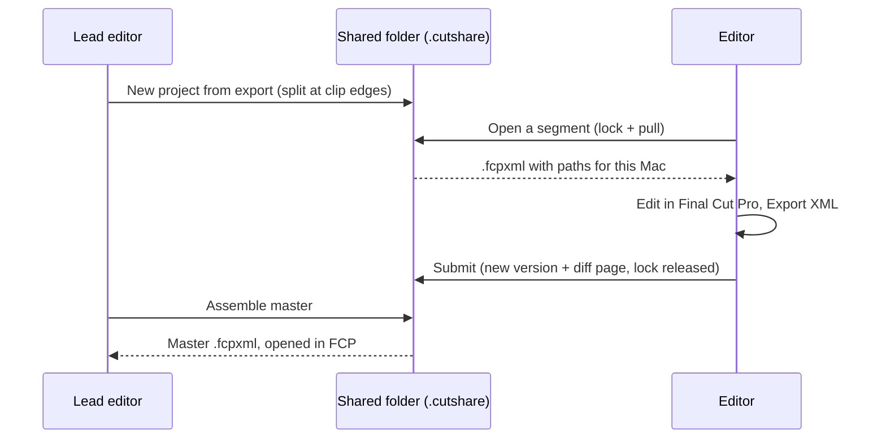
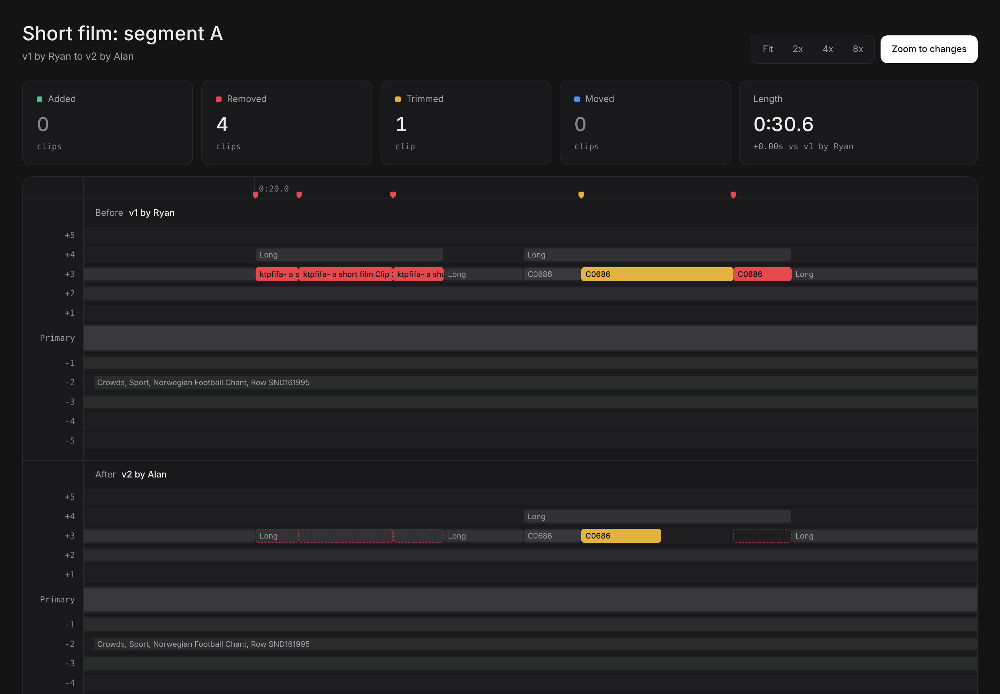
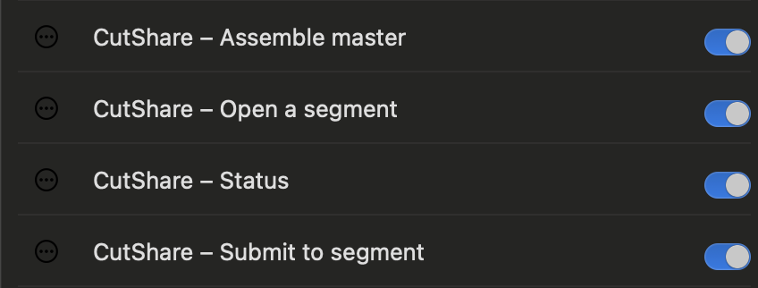
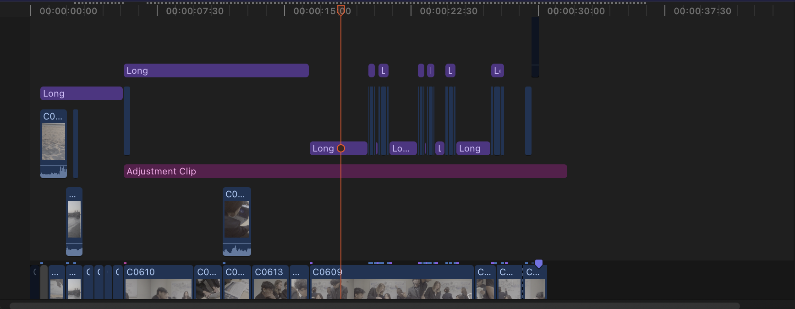

# CutShare design doc

**Author:** Ryan Genova · **Status:** v0.2, tested on real Final Cut Pro 12 projects · **Last updated:** November 2026

## 1. Problem

Club and event videos (theatrical shows, recaps, short films) get cut by one person against a deadline, even when three people could help. Final Cut Pro has no way for two people to work on the same project. The usual workarounds are emailing XML files back and forth or passing a library around, and both lose work and burn time.

**Goal:** let several editors cut different parts of one video at the same time, each in their own copy of FCP, and get one finished timeline back with nothing lost and every change visible.

## 2. Research

### What exists

| Tool | Model | Simultaneous on one timeline? | Notes |
|---|---|---|---|
| Final Cut Pro 12.x | None built in | No | FCPXML stayed on v1.14 through FCP 12.3, Workflow Extension SDK unchanged |
| PostLab (Hedge) | Check-out/check-in of libraries, versioning, event locking | No | Paid, per seat. Works across NLEs |
| DaVinci Resolve | Blackmagic Cloud / Project Server, bin and timeline locking, timeline compare and merge, chat | Different bins and timelines in parallel | The most complete built-in option |
| Premiere Pro | Team Projects, sequence locking, publish, history | Different sequences in parallel | Creative Cloud |
| CapCut | Team spaces, edit permission handed between members | No | Turn-taking, no API |
| Kapwing / invideo | Browser editors, live cursors | Yes | Real-time, but simple timelines and easy to step on each other |

### What that means

1. **Every serious tool chose ownership plus merge, not live co-editing.** Editing is about timing. Two people rippling the same section at once destroy each other's cuts.
2. **A live plugin for FCP isn't possible.** Apple exposes no live timeline API. Outside tools only get FCPXML import/export and Workflow Extensions, panels that can exchange FCPXML and follow the playhead.
3. **The real gap for FCP is free, parallel, section-level editing with an automatic merge.** PostLab locks and versions, but it doesn't stitch several people's work into one timeline or show what changed inside it.

### Should I build it?

As a startup competing with PostLab, no. As a free tool for student and club teams, and as an add-on that does stitching and change tracking on top of whatever sync people already use, yes.

## 3. Goals and non-goals

**Goals**
- Several editors work in parallel on one video in Final Cut Pro
- One action assembles the master. No manual copy-paste between projects
- Every version is kept, and every change is visible at a glance
- Works over storage teams already have (Google Drive, Dropbox, NAS), no server
- Nobody needs Terminal

**Non-goals**
- Live co-editing on one timeline (not possible in FCP, and not desirable, see above)
- Replacing PostLab, Frame.io or Resolve's collaboration
- Syncing media files. Teams share footage or proxies the way they already do

## 4. How it works



### 4.1 Storage

A project is a plain folder, so any sync service works:

```
FASA Recap.cutshare/
  cutshare.json                          id, name, optional Discord webhook
  segments/02-performances/segment.json  name, order
  segments/02-performances/lock.json     who is editing, since when
  segments/02-performances/versions/v003_alan.fcpxml (+ .json, .diff.html)
  assembled/master_v004.fcpxml (+ .json: which segment versions were used)
```

**Decision: one file per version and per lock.** Cloud drives handle two people editing one file badly (conflicted copies). Writing new, uniquely named files means two people syncing at once never touch the same file. Writes go to a temp file and are renamed into place, so a half-synced file is never read.

**Decision: locks are advisory.** A lock is a small file naming the editor. Submit refuses to save over someone else's lock unless forced, and the Finder action asks first. Locks are only as fast as the drive syncs, which is fine for work measured in hours.

### 4.2 Media paths

Every Mac keeps footage somewhere different. On submit, any media path under the editor's footage folder becomes a placeholder (`file:///__CUTSHARE_MEDIA__/clip.mov`), and macOS bookmark blobs (tied to one machine) are dropped. On pull or assemble the placeholder becomes the reader's own folder. Clips outside the footage folder trigger a warning, since teammates won't be able to relink them.

### 4.3 Splitting

Cut times snap to the nearest boundary between storyline clips. A clip is never cut in half, so its connected clips, titles and effects stay whole. A transition sitting exactly on a cut is dropped with a note, because it would overlap two segments. Each segment keeps only the resources it uses, following compound clips into their nested assets.

### 4.4 Assembling

Assembly concatenates storyline items and has to produce one valid FCPXML document:

1. **Re-key.** Every resource id is prefixed per segment (`r4` → `s1_r4`) and all `ref`/`format` attributes are rewritten, so ids from different exports can't collide.
2. **De-duplicate.** Formats match by attributes, assets by `uid` (or source path), effects by `uid`, compound clips by content. The same footage used by three editors becomes one asset. Two different compound clips that share a `uid` stay separate, and the duplicate `uid` is removed so FCP doesn't merge them.
3. **Renumber** to `r1…rN` and rewrite references again.
4. **Unique title styles.** Every FCP export numbers its `text-style-def` ids from `ts1`, and they must be unique in a document, so they're prefixed per segment.
5. **Re-time.** Only top-level storyline offsets shift. Connected clips use time relative to their parent, so they move with it automatically.
6. **Safety checks.** Segments with different frame sizes or rates are refused. Mixed FCPXML versions write the newest one, with a note.

All time math uses exact rationals (`Fraction`) and writes times in the sequence's own timebase, for example `1001/60000s`, so nothing drifts off a frame.

### 4.5 Visual diff

Matching clips between two versions:

1. **Storyline:** a sequence matcher on clip identity (source media plus name). Equal runs are compared for trims. The rest become added or removed, and an item removed in one place and added in another becomes **moved**.
2. **Connected clips:** matched across the whole timeline in three passes: identical (media, lane, in point, length), then same media, lane and in point (a **trim**), then same media anywhere. Each pass pairs the nearest positions first. This handles FCP collapsing lanes after a deletion, and repeated titles that share a name.

The page is one self-contained HTML file with no network needed. Its design follows the [unslop](https://github.com/heydamir/unslop) process:
- **Quiet chrome:** a graphite ramp and three text tones. Unchanged clips are grey, so changes are the only color
- **Status colors** each mean one thing: green added, red removed, amber trimmed, blue moved
- **Signature detail:** marker flags on the time ruler, like FCP's
- **Ghost outlines** show where removed clips used to sit
- **Zoom to changes** frames the edit, since real changes are often a fraction of a second



### 4.6 Mac front end

Five Finder Quick Actions are generated by `macos/make_quick_actions.py` as Automator Run Shell Script workflows. Each one calls `python3 -m cutshare ui <action>` with the full Python path baked in, because Finder runs Quick Actions without the user's shell `PATH` (conda, Homebrew). Questions use native dialogs via `osascript`. If macOS blocks dialogs from a Quick Action, they're re-shown through Finder. Errors appear as alerts and are logged to `~/.cutshare/ui.log`.



## 5. Testing

| Layer | How |
|---|---|
| Time math, splitting, merging, path rewriting | Unit tests |
| Team workflow | Simulated three editors on three Macs with different footage paths: split, lock conflicts, submit, diff, assemble |
| Mac front end | Every Quick Action flow driven by scripted dialog answers, plus the generated Automator bundles |
| Real projects | Two exports from a real FCP 12 short film (59.94p, 11 lanes, 72 clips, 55 resources, compound clips, adjustment layers, retimes, keyframed masks): split and re-assemble with zero differences, and the visual diff finds exactly the 5 real changes |
| Format validity | Output validated against Apple's FCPXML 1.11 and 1.13 DTDs, and a real FCP 1.8 export round-trips with zero differences |
| End to end | Imported into Final Cut Pro 12: segments and an assembled 1:19 master kept every color grade, sound effect and title (see below) |

CI runs the suite on Linux and macOS for Python 3.9 to 3.13.

A segment after a round trip through CutShare, back in Final Cut Pro:



## 6. Limits and risks

- Library-only data (transcripts, visual search, Magnetic Mask analysis) doesn't travel through FCPXML.
- Third-party effects must be installed on every Mac.
- Newer FCPXML can't be imported by older FCP, so the team should share one FCP version.
- Locks depend on sync speed.
- Boundary transitions are dropped (by design, with a note).

## 7. What's next

1. A pilot on a real club video with 2 to 3 editors, measuring time to first full cut versus one editor alone
2. An FCP Workflow Extension panel (Swift) showing segment status inside FCP
3. Review comments that land as FCP markers
4. Edit analytics from version history: revisions per segment, length over time, cuts per minute

## Appendix: commands

`init`, `whoami`, `media-root`, `add`, `split`, `status`, `claim`, `release`, `pull`, `submit`, `diff [--html|--open]`, `log`, `assemble`, `discord`, `ui`. See `cutshare --help`.
